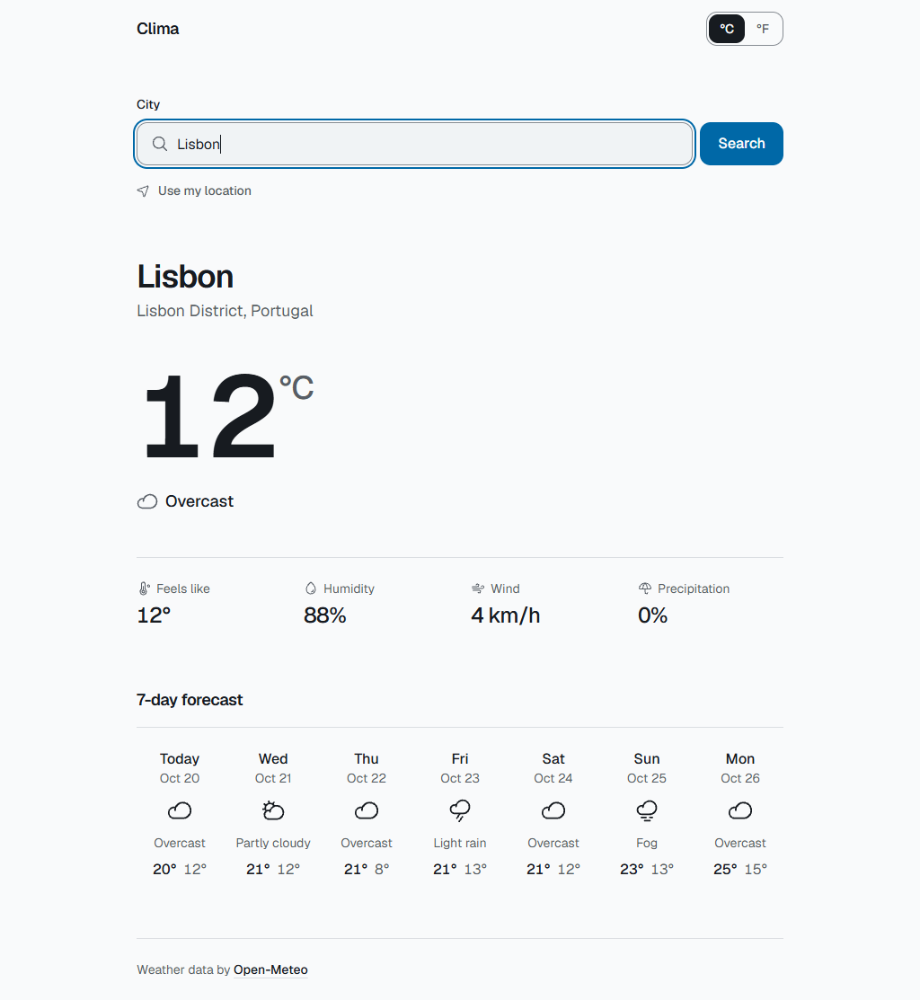
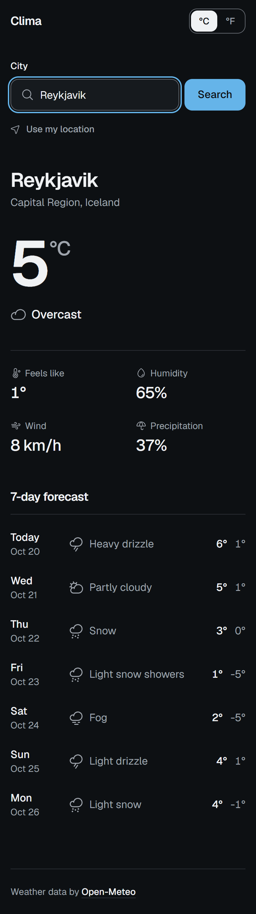

# Clima

A minimal weather app with real-time conditions and a 7-day forecast for any city, in a clean, responsive interface.

<p>
  
  
</p>

## Features

- **City search** with Enter-to-search and support for qualifiers such as "Paris, Texas"
- **Current weather**: temperature, condition, feels-like, humidity, wind and chance of precipitation
- **7-day forecast** with highs, lows and conditions, dated in the location's own time zone
- **Use my location** through the browser's geolocation, with a readable place name
- **Celsius / Fahrenheit** toggle, remembered between visits
- **Responsive** layout from phones to desktop, with no horizontal scrolling
- **Accessible**: semantic HTML, labelled controls, keyboard support, visible focus, screen-reader announcements and WCAG AA contrast
- **Light and dark mode** that follow the system setting
- **Complete states** for loading, empty, not found, offline, timeout and denied location access
- Respects **reduced motion**

## Tech stack

- [React 19](https://react.dev) + [TypeScript](https://www.typescriptlang.org) (strict)
- [Vite](https://vite.dev) for development and production builds
- [Tailwind CSS v4](https://tailwindcss.com) with design tokens for both color schemes
- [Vitest](https://vitest.dev) + [Testing Library](https://testing-library.com) for unit and integration tests
- [oxlint](https://oxc.rs) for linting
- [Phosphor Icons](https://phosphoricons.com) and the self-hosted [Geist](https://vercel.com/font) typeface

## APIs

Clima calls public APIs directly from the browser. **No API keys, accounts or environment variables are needed.**

| Service | Used for |
| --- | --- |
| [Open-Meteo Geocoding API](https://open-meteo.com/en/docs/geocoding-api) | Turning a city name into coordinates |
| [Open-Meteo Forecast API](https://open-meteo.com/en/docs) | Current conditions and the daily forecast, in one request |
| [BigDataCloud Reverse Geocoding](https://www.bigdatacloud.com/free-api/free-reverse-geocode-to-city-api) | Naming the user's location for "Use my location" |

**Privacy:** when you use your location, the coordinates are rounded to about 1 km before being sent to these two services, and they are never stored. The only thing Clima saves is your temperature unit, in `localStorage`.

## Running locally

Requires [Node.js](https://nodejs.org) 20.19+ or 22.12+.

```bash
git clone https://github.com/EinsLayupan19/clima.git
cd clima
npm install
npm run dev
```

Then open the URL Vite prints (usually http://localhost:5173).

## Testing

```bash
npm test          # run the test suite once
npm run test:watch  # re-run tests on change
npm run lint      # lint with oxlint
npm run build     # type-check and build for production into dist/
npm run preview   # serve the production build locally
```

The tests cover API parsing and error handling, weather-code mapping, unit conversion, date formatting, saved preferences, geolocation errors, and the full search, location, forecast and error flows in a simulated browser. Network requests and geolocation are faked, so the suite runs offline.

## Architecture

```text
src/
├── components/   UI only: render props, no fetching
├── hooks/        useWeather (request lifecycle), useTemperatureUnit (saved unit)
├── lib/          weatherApi (HTTP, parsing, errors), geolocation, unitPreference, weatherUtils
├── types/        shared TypeScript types
├── App.tsx       composes the page and maps state to UI
└── main.tsx      entry point
```

- **API layer** (`lib/weatherApi.ts`) is the only code that talks to the network. It validates every response and turns raw API data into small app-friendly types, so components never see raw JSON. Failures become typed errors (`network`, `timeout`, `server`, `invalid-response`).
- **Hooks** own state. `useWeather` runs one request at a time (city search or current location) and cancels the previous one, so a slow response can never overwrite a newer result.
- **Utilities** (`lib/weatherUtils.ts`) are pure functions: weather-code labels and icons, date formatting and the single place where temperatures are converted between units.
- **Components** stay presentational and receive already-shaped data.
- **Types** (`types/weather.ts`) describe locations, weather, requests and every UI state as a discriminated union.

## Deployment

Clima is a static single-page app with no routing or server code. Any static host works:

```bash
npm run build   # outputs dist/
```

On Vercel or Netlify, import the repository and keep the detected Vite defaults (build command `npm run build`, output directory `dist`). Browser geolocation requires HTTPS, which these hosts provide.

## Credits

- Weather and city search data by [Open-Meteo](https://open-meteo.com), licensed under [CC BY 4.0](https://open-meteo.com/en/license)
- Reverse geocoding by [BigDataCloud](https://www.bigdatacloud.com)
- [Geist](https://vercel.com/font) typeface by Vercel, SIL Open Font License
- [Phosphor Icons](https://phosphoricons.com), MIT License
